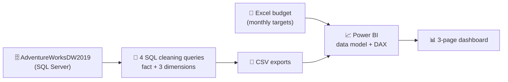

# 📈 Sales Analysis: SQL + Power BI Dashboard


> **How much did we sell, of what products, to which customers, and how did we perform against budget?**
> An end-to-end project that turns a Sales Manager's business request into a data model and an interactive Power BI dashboard, using SQL Server (AdventureWorks) and an Excel budget.


---

## 📑 Table of Contents

1. [Business Request](#-business-request)
2. [Key Results](#-key-results)
3. [Dashboard Pages](#-dashboard-pages)
4. [How It Was Built](#%EF%B8%8F-how-it-was-built)
5. [Data Model](#-data-model)
6. [Repository Structure](#-repository-structure)
7. [How to Use](#-how-to-use)
8. [Notes and Limitations](#%EF%B8%8F-notes-and-limitations)
9. [Author](#-author)

---

## 💼 Business Request

Steven, the Sales Manager, asked to move from **static reports to visual dashboards** showing how much was sold, of which products, to which customers, and how that has trended over time. Each salesperson works with different products and customers, so the dashboard also needed filters. Sales are measured against a budget supplied in Excel, and analysis usually covers the **last two years**.

**User stories delivered**

| # | As a… | I want… | So that I can… |
|:-:|---|---|---|
| 1 | Sales Manager | A dashboard overview of internet sales | See which customers and products sell best |
| 2 | Sales Representative | Internet sales broken down by customer, with filters | Follow up the customers who buy the most |
| 3 | Sales Representative | Internet sales broken down by product, with filters | Track the products that sell the most |
| 4 | Sales Manager | Sales over time compared to budget | See performance against target with KPIs |

---

## 🔍 Key Results

Results below are for **2020**, the full year shown in the report and the year covered by the budget.

| Metric | Value |
|---|---|
| Total sales | **$16.35 M** |
| Budget | **$15.30 M** |
| Variance | **+$1.05 M (+6.9% above budget)** |
| Months at or above budget | **8 of 12** |
| Orders / customers | **21,289 orders from 17,429 customers** |

**What the data shows**

- 🚲 **Bikes drive the business.** They account for **93.9%** of 2020 sales, followed by Accessories (4.1%) and Clothing (2.0%).
- 🏔️ **Mountain-200 bikes lead.** The top six products are all Mountain-200 variants (Black and Silver, sizes 38–46), each earning $0.9M–$1.0M.
- 📈 **Strong growth through the year.** Monthly sales rose from about $0.86 M in January to $1.87 M in December, and 2020 sales were roughly **2.8×** those of 2019 ($5.84 M).
- 🎯 **Budget was missed in four months:** February, July, September and December. December had the highest budget of the year ($2.0 M) and fell about $126K short.
- 👤 **Customer spend is spread out.** The top customer, Jordan Turner, accounts for about $11.5K, so no single customer dominates.

---

## 📊 Dashboard Pages

The Power BI report (`Sales Report.pbix`) has three pages with year and month slicers across the top.

**1. Sales Overview:** sales vs budget KPI, sales by product category, top 10 customers, top 10 products, sales by city map, and monthly sales vs budget.


**2. Customer Details:** top 10 customers and a monthly sales matrix per customer, with city, category and product filters.


**3. Product Details:** top 10 products and a monthly sales matrix per product, with city, category and product filters.


A PDF export of the report is also included (`Sales Report.pdf`).

---

## 🛠️ How It Was Built



### Step 1: Extract and clean with SQL
Each query selects only the columns the dashboard needs and renames them to business-friendly names.

| Query | Purpose |
|---|---|
| `FACT_InternetSales_Clean.sql` | Sales transactions (product, customer, order/due/ship dates, order number, sales amount). A **rolling filter** keeps only the last two years of orders, so the extract stays current on every run. |
| `DIM_Calendar_Clean.sql` | Date table from 2019 onward, with day, month, short month name (for charts), month number, quarter and year. |
| `DIM_Customer_Clean.sql` | Customers with a combined full name, readable gender labels, first purchase date, and city joined in from the geography table. |
| `DIM_Product_Clean.sql` | Products with sub-category and category joined in, plus colour, size, product line, model name, description and status. |

### Step 2: Combine with the budget
The Sales Manager's Excel file (`Sent Over Data - SalesBudget.xlsx`) holds a monthly budget (Date, Budget), which is loaded alongside the SQL exports.

### Step 3: Model and visualise in Power BI
The cleaned tables are linked into a star schema, then used to build the KPI card, charts, matrices, map and slicers described above.

---

## 🧩 Data Model

| Table | Type | Rows | Key columns |
|---|---|--:|---|
| `FACT_InternetSales` | Fact | 58,168 | ProductKey, CustomerKey, OrderDateKey, SalesOrderNumber, SalesAmount |
| `DIM_Product` | Dimension | 606 | ProductKey, Product Name, Sub Category, Product Category |
| `DIM_Customer` | Dimension | 18,484 | CustomerKey, Full Name, Gender, Customer City |
| `DIM_Calendar` | Dimension | 1,096 | DateKey, Date, Month, Quarter, Year |
| `Budget` | Target | 18 | Date, Budget (monthly) |

The fact table joins to each dimension on its key (for example `OrderDateKey` to `DateKey`), and the budget is matched to sales by month.

---

## 📂 Repository Structure

```
├── sql/
│   ├── FACT_InternetSales_Clean.sql
│   ├── DIM_Calendar_Clean.sql
│   ├── DIM_Customer_Clean.sql
│   └── DIM_Product_Clean.sql
├── data/
│   ├── FACT_InternetSales_Export.csv
│   ├── DIM_Calendar_Export.csv
│   ├── DIM_Customer_Export.csv
│   ├── DIM_Product_Export.csv
│   └── Sent Over Data - SalesBudget.xlsx
├── dashboard/
│   ├── Sales Report.pbix
│   └── Sales Report.pdf
├── docs/
│   ├── Business Demand Overview & User Stories.docx
│   └── Example Business Request.docx
├── screenshots/                  # dashboard page images used in this README
└── README.md
```

---

## 🚀 How to Use

**Just view the results**
Open `dashboard/Sales Report.pbix` in **Power BI Desktop** (Windows), or read the PDF export `dashboard/Sales Report.pdf`.

**Rebuild from the source database**
1. Restore the **AdventureWorksDW2019** sample database in SQL Server.
2. Run each query in `sql/` and export the results (the `data/` folder already contains the exports).
3. In Power BI, load the four CSVs and the budget workbook, then relate the tables on their keys.
4. For a daily refresh, publish the report and schedule it in the Power BI Service.

---

## ⚠️ Notes and Limitations

- **Partial 2021 data:** orders in the source run only to **28 January 2021**, so 2021 totals ($45.7K) are not a full period. Year-over-year comparisons are best made on 2019 vs 2020.
- **Budget coverage:** the budget file covers **January 2020 to June 2021**, even though the request mentions a 2021 budget. The report compares 2020 results against budget.
- **Product status label:** the SQL uses `ISNULL(p.Status, 'Outdated')`. Because `ISNULL` keeps the data type of its first argument, the value is cut to `Outdate` in the export. Using `COALESCE` or a `CAST` would fix this.
- **Many unsold products:** `DIM_Product` has 606 items, but only 133 appear in sales. The rest (such as components) have no category and do not affect the dashboard.
- **Rolling date filter:** the fact query is based on today's date (`YEAR(GETDATE()) - 2`), so the date range moves each year it is rerun.

---

## 👤 Author

**Shivi Gupta**
[LinkedIn](https://linkedin.com/in/shivi-gupta-6271a8371) · [GitHub](https://github.com/Shivigupta0899)

⭐ If you found this project useful, consider giving it a star!

